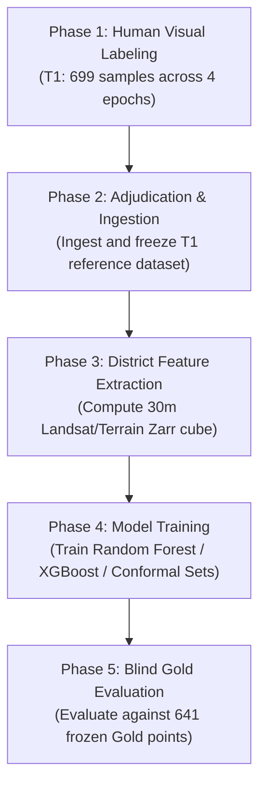

# GeoVerse Model 1: Machine Learning Data Readiness Report

**Report Date:** October 21, 2026  
**Scope:** Model 1 (Historical LULC Classification & Confirmatory Experiments C1–C6)  
**Target Repository:** `C:\Users\prana\OneDrive\Desktop\3rd SEM\Group Projects\EDI\GeoVerse\lulc-p1-p6`  

---

## 1. Executive Summary & Training Decision

This report evaluates whether machine learning features, predictor rasters, reference labels, and training pipelines are sufficient to proceed with model training and confirmatory experiments.

### Definitive Recommendation:
> ### **TRAINING READINESS DECISION: NO-GO**
> 
> Proceeding to model training at this stage is strictly prohibited. The project faces two absolute scientific blockers:
> 1. **Zero Ground-Truth Labels:** Neither training nor evaluation reference labels exist (0 / 1,340 samples interpreted).
> 2. **Absent District Feature Cube:** The wall-to-wall $30\text{ m}$ Zarr feature cube (`data/features/cube/pune_G30.zarr`) is not built on disk.
> 
> Any model trained on unverified or synthetic data would violate the pre-registered scientific protocol and fail the automated preflight guards (`Refusal`).

---

## 2. Empirical Feature Pipeline & Raster Audit

An audit of the local raster assets and sidecar metadata (`metadata.json`) in `phase1/data/pune-eo-phd 9/` yielded the following empirical parameters:

| Parameter | Specification in Local TIFs | Status for Full District |
|---|---|---|
| **CRS** | `EPSG:32643` (UTM Zone 43N) | Aligns with target district definition |
| **Pixel Resolution** | $30.0\text{ m} \times 30.0\text{ m}$ | Matches Landsat standard |
| **Dimensions** | Width: 709, Height: 522 (370,098 pixels) | Local window only ($21.2\text{ km} \times 15.6\text{ km}$) |
| **Bounds (UTM 43N)** | $[364785.0, 2036985.0, 386055.0, 2052645.0]$ | Covers Khadakwasla Mutha corridor only |
| **Affine Transform** | `[30.0, 0.0, 364785.0, 0.0, -30.0, 2052645.0]` | Verified |
| **Spectral Bands** | 6 bands: `blue`, `green`, `red`, `nir08`, `swir16`, `swir22` | Scale: `2.75e-05`, offset: `-0.2` |
| **Temporal Coverage** | 1990 and 2026 dry season | Historical 2000, 2010 missing locally |
| **QA Mask Bits** | Bit 0: fill, Bit 1: dilated_cloud, Bit 2: cirrus, Bit 3: cloud, Bit 4: shadow, Bit 5: snow | Verified in `qa.tif` |
| **Valid Pixel Fraction** | 100% in local corridor (`district_valid_fraction: 1.0`) | Full district uncomputed |
| **Full District Cube** | `data/features/cube/pune_G30.zarr` (95.3 GB) | **ABSENT (Exists: False)** |
| **Terrain Covariates** | SRTM/ALOS elevation, slope, aspect | **ABSENT (OOM_KILLED during pilot)** |

---

## 3. Training & Evaluation Pipeline Status

### 3.1 Preflight Guards (`src/pune_eo/confirmatory/guards.py`)
The existing pipeline implements strict fail-closed preflight checks:
- Guard `F["gold"]`: Asserts `Tier-A gold` manifest is `FROZEN` with matching SHA-256 in `data/labels/gold/phase4/ingested/gold_reference_labels.csv`.
- Guard `F["T1"]`: Asserts `T1 v2` manifest is `FROZEN` with matching SHA-256 in `data/labels/training/phase6_T1v2/ingested/gold_reference_labels.csv`.
- Guard `F["cube"]`: Asserts presence and integrity of `pune_G30.zarr`.

When tested against the current repository state:
```json
{
  "gold_status": "NOT_AVAILABLE (no human Tier-A gold labels exist)",
  "t1_status": "NOT_AVAILABLE (no human T1 labels exist)",
  "cube_status": "PILOT (not complete), feature_cube exists: False"
}
```
Attempting to run any confirmatory experiment (C1 through C6) triggers an immediate `Refusal`.

---

## 4. Path to Training Readiness

To transition from **NO-GO** to **GO**, the following sequential prerequisites must be completed:



1. **Complete T1 Visual Reference Annotation:** A human interpreter must inspect historical imagery for all 699 T1 points and record dominant classes and area shares.
2. **Execute Ingestion & Freeze:** Run `python src/validation/ingest_gold.py --kind training freeze pass1` to generate immutable reference tables.
3. **Build Sample Feature Matrix:** Extract spectral and temporal predictors from Landsat Collection 2 for the 699 sample locations (or build the full district Zarr cube).
4. **Initiate Model Training:** Proceed with pre-registered baseline training (C1–C6).

---

## 2026-10-21 completion-audit addendum

The no-go decision remains. A fresh scan found no local `.zarr` cube and no verified genuine human labels. Although one partial T1 epoch record exists in app storage, it lacks provenance needed to treat it as a reference label. No training, tuning, evaluation, metric, or prediction was run. The existing archived pipeline descriptions identify the intended generation route, but the executable source tree and its required external data/credentials are not present in this checkout; reconstructing or downloading them was intentionally not attempted. Required next inputs are protocol-compliant human labels, frozen ingestion artifacts, and a validated full-district cube produced by the documented pipeline on adequately provisioned infrastructure.
