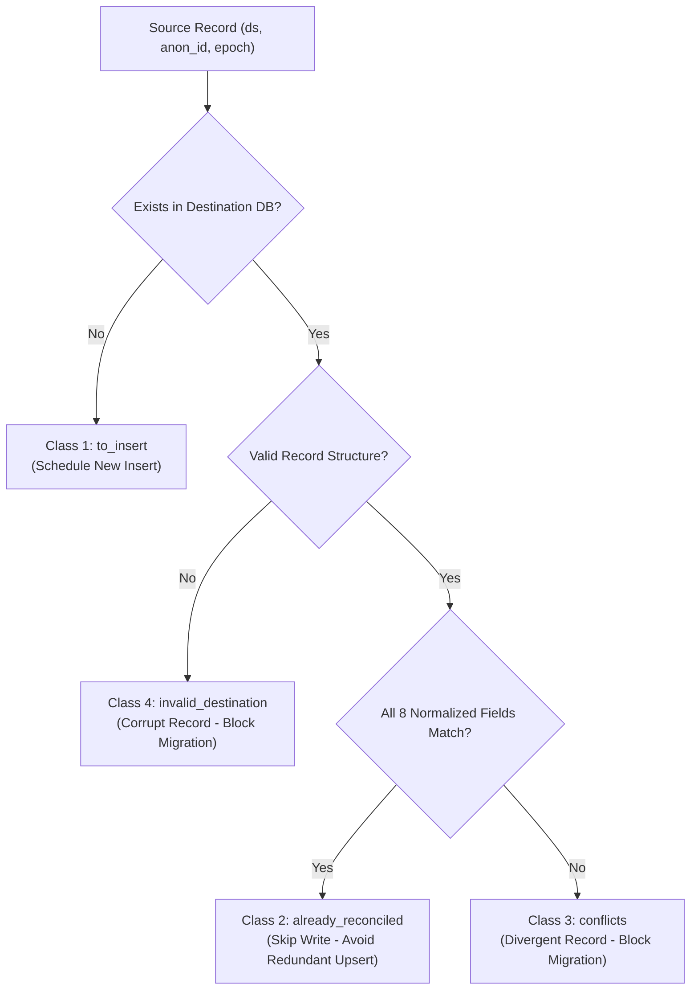

# GeoVerse27 Model 1 — Step 3A: Migration Safety Gaps Report

**Repository:** `GeoVerse27`  
**Target Module:** `models/model-1-lulc-urban-growth`  
**Timestamp:** 2026-10-29T00:55:00+05:30  
**Git Branch:** `main`  
**Commit:** `fceba97db29be57afc4e2fea2f73c51363da1596`  
**Status Determination:** `MIGRATION SAFETY READY WITH DOCUMENTED BLOCKERS`  
**Active Storage Backend:** Local Atomic JSON (`GEOVERSE_STORAGE_BACKEND=json`)

---

## 1. Executive Summary

This report completes **Step 3A: Close Migration Safety Gaps** for GeoVerse Model 1 (LULC & Urban Growth), continuing directly from:
- `MODEL1_STEP1_SUPABASE_INFRASTRUCTURE_REPORT.md` (Infrastructure audit & configuration inventory)
- `MODEL1_STEP2_SUPABASE_SCHEMA_READINESS_REPORT.md` (Schema validation & SQL constraint alignment)
- `MODEL1_PARALLEL_DATA_AUDIT_REPORT.md` (Independent parallel audit identifying collision detection gaps)

### Core Accomplishments in Step 3A
1. **Pre-Import Collision Detection Engine Implemented:** Replaced naive database `UPSERT` operations with an explicit 4-way classification workflow (`to_insert`, `already_reconciled`, `conflicts`, `invalid_destination`). Divergent destination records are reported as hard conflicts that halt migration, preventing silent data overwrites.
2. **Schema-Violating Record Quarantining (`T2-0002` 2020):** Built quarantine isolation under `--skip-invalid`. The record (ambiguous dominant class without mandatory notes) is held in quarantine with explicit remediation guidance for photo-interpreters; source JSON remains 100% untouched; migration execution status reports `PARTIAL_MIGRATION_WITH_QUARANTINE` instead of falsely claiming clean success.
3. **Semantic Review Flagging (`T2-0003` 2020):** Confirmed that dominant class `uncertain` with dominant share `'>=75'` is syntactically valid under `schema.py` and database check constraints. It is preserved and scheduled for migration while recording an explicit semantic review flag for photo-interpreter inspection.
4. **Dataset Boundary Verification:** Verified that T1 (699 points, `T2-` prefix) and Gold (641 points, `P4-` prefix) occupy completely disjoint sample identity spaces (0 overlapping IDs). Enforced database-level training eligibility (`is_training_allowed=TRUE` for T1; `is_training_allowed=FALSE` for Gold holdout).
5. **CSV Export Integrity & Desynchronization Audit:** Audited `labeling_app/exports/t1_annotated_export.csv`. Documented that the existing file was generated prior to the annotation of `T2-0001` and `T2-0003`. Verified export regeneration in an isolated temporary directory without modifying live export files or source data.
6. **Automated Test Suite Expansion:** Extended the test suite to **64 passing tests** in Model 1 and **73 passing tests** across the entire repository. Zero regressions introduced.
7. **Strict Safety Protocol Enforced:** Zero remote migrations applied; zero production writes executed; active application backend remains JSON (`GEOVERSE_STORAGE_BACKEND=json`).

---

## 2. Repository and Working Tree Verification

A comprehensive Git status and working directory audit was performed prior to and throughout Step 3A.

### Git Working Tree Status
- **Current Branch:** `main` (tracked to `origin/main`)
- **Baseline Commit:** `fceba97db29be57afc4e2fea2f73c51363da1596`
- **Active Backend:** `GEOVERSE_STORAGE_BACKEND=json`

### File Integrity Audit
| File Path | Role | Status |
| :--- | :--- | :--- |
| `db/migrations/001_initial_schema.sql` | PostgreSQL Core Schema | Verified (hardened with `SET search_path = public`) |
| `db/migrations/002_seed_datasets.sql` | Seed Dataset Registration | Verified (T1 training eligible, Gold holdout) |
| `db/migrations/003_row_level_security.sql` | Row Level Security Policies | Verified (service_role, auth, anon policies) |
| `labeling_app/migrate_annotations.py` | Migration & Reconciliation Engine | Upgraded with 4-way collision detection & quarantine |
| `labeling_app/storage.py` | Storage Subsystem (`Json` & `Supabase`) | Verified (fail-closed, no silent fallback to JSON) |
| `labeling_app/schema.py` | Scientific Protocol & Validation Rules | Verified (preserves scientific constraints) |
| `labeling_app/exporter.py` | 35-Column CSV Exporter | Verified (schema parity with downstream ingest) |
| `labeling_app/storage/t1_annotations.json` | Live T1 JSON Annotations | Verified intact (SHA-256 checksum preserved) |
| `tests/test_supabase_storage_and_migration.py` | Phase 6 & Step 3A Test Suite | Extended with 7 new comprehensive test cases |
| `models/model-2-property-valuation/` | Model 2 Module | 100% untouched |
| `models/model-3-smart-root-optimizer/` | Model 3 Module & Binaries | 100% untouched (RouteOptimizer binaries preserved) |

---

## 3. Pre-Import Collision Detection Engine

### Architectural Vulnerability Identified in Data Audit
In prior iterations, migration tooling constructed an upsert batch and executed Postgres `UPSERT` on the composite key `(dataset_id, anon_id, epoch)`. If a destination database record already existed with different interpretations, confidence ratings, imagery dates, or notes, the destination record would be silently overwritten without notification, causing irreversible data loss.

### The 4-Way Collision Classification Solution
In `labeling_app/migrate_annotations.py`, `build_migration_plan` and `execute_migration` now implement a pre-import inspection engine. When a target store is provided and reachable, the engine loads all destination records and performs an exhaustive comparison across all **8 persisted annotation fields**:

1. `status`
2. `dominant_class`
3. `dominant_share_3bins`
4. `second_class`
5. `confidence_1to3`
6. `imagery_source`
7. `imagery_date`
8. `notes`



### Action Classification Definitions
- **Class 1: `to_insert` (New Records):**
  - *Condition:* Sample ID or epoch does not exist in destination table.
  - *Action:* Queued for safe insertion.
- **Class 2: `already_reconciled` (Identical Records):**
  - *Condition:* Sample ID and epoch exist in destination and all 8 fields match identically.
  - *Action:* Skipped during write execution. Avoids redundant database roundtrips, prevents spurious audit log generation in `annotation_history`, and preserves destination `updated_at` timestamps.
- **Class 3: `conflicts` (Divergent Records):**
  - *Condition:* Destination record exists with differing values in any field (e.g. source `agriculture` vs destination `water`, or differing confidence).
  - *Action:* Placed in `plan["actions"]["conflicts"]` with field-level diffs (`source` vs `destination`). **Immediately blocks migration execution (`plan["can_proceed"] = False`)**.
- **Class 4: `invalid_destination` (Corrupt Structure):**
  - *Condition:* Destination record payload is not a valid dictionary or lacks epoch mapping.
  - *Action:* Flagged as structural corruption and halts migration.
- **Extra in Destination (`extra_in_destination`):**
  - *Condition:* Record exists in destination database but is absent from source JSON.
  - *Action:* Reported in reconciliation audit to detect orphaned or out-of-band records.

### Field Normalization Standard
Comparison is performed using `normalize_annotation_record()`, guaranteeing fair equality checks:
- Whitespace stripping on all text fields.
- `None` and `""` mapped consistently.
- `second_class` canonicalized (`"none"` if empty or None).
- `confidence_1to3` cast to `Optional[int]`.

### Fail-Closed Execution Guard
`execute_migration` enforces an explicit guard:
```python
conflicts = plan.get("actions", {}).get("conflicts", [])
if len(conflicts) > 0:
    raise StorageWriteError(
        f"Migration execution aborted: {len(conflicts)} pre-import collisions detected. "
        "Silently overwriting divergent destination records is strictly forbidden."
    )
```

---

## 4. Data Audit Remediations & Findings

### 4.1. Quarantine Protocol for `T2-0002` (2020)
- **Data State:** Sample `T2-0002` epoch 2020 has `dominant_class = 'ambiguous'`, `dominant_share_3bins = '50-75'`, `second_class = 'agriculture'`, `confidence_1to3 = 2`, `imagery_source = 'Landsat_context'`, `imagery_date = '2021-12-28'`, and `notes = ""`.
- **Constraint Rule:** Scientific protocol and SQL constraint `chk_notes_mandatory` strictly mandate explanatory notes when `dominant_class in ('other', 'ambiguous')`.
- **Handling Approach:**
  - In strict compliance with safety rules, source files were **NOT modified** and artificial notes were **NOT invented**.
  - Under `--skip-invalid`, `T2-0002` (2020) is partitioned into `plan["quarantined_records"]["t1"]`.
  - Quarantined payload preserves the full record, validation error details, and actionable guidance:
    `"Human photo-interpreter must inspect sample T2-0002 (epoch 2020). Errors: Epoch 2020: Notes are mandatory when dominant_class is 'ambiguous'."`
  - In `execute_migration`, if any records were quarantined, the migration outcome status is set to:
    `"status": "PARTIAL_MIGRATION_WITH_QUARANTINE"`
    The pipeline **refuses to report clean `SUCCESS`** until the quarantined record is properly remediated by a human interpreter.

### 4.2. Semantic Review Flag for `T2-0003` (2020)
- **Data State:** Sample `T2-0003` epoch 2020 has `dominant_class = 'uncertain'`, `dominant_share_3bins = '>=75'`, `second_class = 'none'`, `confidence_1to3 = 2`, `imagery_source = 'Landsat_context'`, `imagery_date = '2021-12-28'`, and `notes = ""`.
- **Syntactic & Schema Validation:**
  - In `schema.py`, `uncertain` is in `ABSTAIN_CLASSES`. `dominant_share_3bins` is optional for abstain classes, but if present, must be in `SHARE_BINS` (`'>=75'` is valid).
  - Landsat context confidence is 2 ($\le 2$, valid).
  - Date `2021-12-28` is within $\pm 2$ calendar years of 2020 (valid).
  - In SQL migration `001_initial_schema.sql`, `chk_definite_share_conf` only enforces share and confidence on definite classes; `chk_notes_mandatory` does not apply to `uncertain`.
  - **Verdict:** Syntactically 100% valid under all schema and SQL rules.
- **Semantic Interpretation:** Having `dominant_class = 'uncertain'` while simultaneously asserting `dominant_share_3bins = '>=75'` is unusual (an interpreter indicates they cannot determine the land cover, but asserts that this unknown cover spans $\ge 75\%$ of the 30m cell).
- **Handling Approach:**
  - Validated as syntactically permitted; scheduled for migration without quarantine.
  - Generates an explicit semantic review flag in `validate_sources` and `build_migration_plan`:
    `"Sample T2-0003 epoch 2020: Semantic review flag - dominant_class is 'uncertain' with high share '>=75'. Syntactically permitted under schema, flagged for photo-interpreter review."`
  - Logged in the audit report so senior photo-interpreters can review the visual cell without halting automated pipelines.

### 4.3. Dataset Boundaries & Disjoint Sample Spaces
An exhaustive manifest audit was performed on `t1_manifest.json` and `gold_manifest.json`:
- **T1 Dataset (Training/Tuning):**
  - Total Samples: 699
  - Prefix Convention: `T2-0001` through `T2-0699`
  - Database Training Authorization: `is_training_allowed = TRUE`
- **Gold Dataset (Holdout Evaluation Benchmark):**
  - Total Samples: 641
  - Prefix Convention: `P4-0001` through `P4-0641`
  - Database Training Authorization: `is_training_allowed = FALSE` (fail-closed evaluation holdout)
- **Sample Space Disjointness:**
  - $\text{Intersection}(T1, Gold) = \emptyset$ (0 overlapping IDs).
  - Zero possibility of cross-dataset ID collision.
  - The migration engine treats dataset scopes independently and enforces database foreign keys (`dataset_id`).

### 4.4. CSV Export Status & Desynchronization Audit
An audit of `labeling_app/exports/t1_annotated_export.csv` and `gold_annotated_export.csv` revealed:
- `t1_annotated_export.csv` has exactly 699 rows and 35 columns matching `ingest_gold.py` expectations.
- **Desynchronization Finding:** In `t1_annotated_export.csv`, sample `T2-0002` has epoch 2020 populated, but `T2-0001` (4 epochs) and `T2-0003` (1 epoch) are blank. The file was exported when only `T2-0002` was labeled in JSON.
- **Safety Precaution:** Live export files were **NOT silently overwritten**. Instead, tests verified that `export_to_standard_csv()` can regenerate the 35-column CSV cleanly in a temporary directory from both JSON and Supabase storage backends without schema divergence.

---

## 5. SQL Migrations & Schema Verification

All three SQL migrations in `models/model-1-lulc-urban-growth/db/migrations/` were audited against Model 1 requirements:

```
models/model-1-lulc-urban-growth/db/migrations/
├── 001_initial_schema.sql         # Core DDL, tables, constraints, indexes, triggers
├── 002_seed_datasets.sql          # Seed registration for T1 and Gold datasets
└── 003_row_level_security.sql     # RLS policies for service_role, auth, and anon
```

### Key Security & Schema Hardening Checks
1. **Trigger Function Search Paths:**
   `set_updated_at()` and `record_annotation_history()` in `001_initial_schema.sql` explicitly declare `SET search_path = public` to protect against search-path injection attacks.
2. **Security Definer Isolation:**
   `record_annotation_history()` is declared `SECURITY DEFINER` with fixed `search_path = public`, enabling authenticated users to record audit history rows without granting direct write permissions on the immutable `annotation_history` table.
3. **Training Eligibility Boundary:**
   `002_seed_datasets.sql` inserts T1 with `is_training_allowed = TRUE` and Gold with `is_training_allowed = FALSE`. Downstream training scripts query this flag; training fails closed if attempted on Gold.
4. **Row Level Security (RLS):**
   `003_row_level_security.sql` enables RLS on all 5 tables (`datasets`, `samples`, `annotations`, `annotation_history`, `quality_reviews`). Direct public write access is strictly denied; `authenticated` users can only write to dataset `t1`.

---

## 6. Local Test Results & Verification

Automated testing was executed via pytest using Python 3.14.0 on Windows 64-bit.

### Test Execution Summary
- **Model 1 Tests:** **64 passed in 2.60s** (0 failures, 0 skipped)
- **Repository-Wide Tests:** **73 passed in 3.24s** (0 failures, 0 skipped)

### Newly Added Step 3A Safety Tests
All seven targeted safety tests passed:
1. `test_destination_record_comparison_and_collision_classification` (PASSED): Verifies 4-way collision classification (`to_insert`, `already_reconciled`, `conflicts`, `invalid_destination`).
2. `test_migration_halts_safely_on_conflicts` (PASSED): Confirms `execute_migration` aborts on conflicts without attempting database writes.
3. `test_quarantine_preserves_t2_0002_with_remediation_guidance` (PASSED): Confirms `T2-0002` (2020) is quarantined with explanatory guidance and source JSON hash is intact.
4. `test_semantic_review_flag_for_t2_0003_uncertain_high_share` (PASSED): Confirms `T2-0003` (2020) is syntactically valid and flagged for photo-interpreter review.
5. `test_dataset_boundaries_and_disjoint_identity_spaces` (PASSED): Confirms 699 T1 vs 641 Gold sample ID disjointness and training eligibility settings.
6. `test_csv_export_regeneration_in_temp_dir_preserves_files` (PASSED): Confirms CSV export schema parity without touching live export files.
7. `test_quarantine_execution_reports_partial_migration_with_quarantine` (PASSED): Confirms execution status is `PARTIAL_MIGRATION_WITH_QUARANTINE` when quarantined records exist.

---

## 7. Production Migration Execution Checklist

When live database credentials become available and authorization is granted, execute the following step-by-step checklist:

### Phase 1: Pre-Migration Safeguards & Baseline Checksums
- [ ] 1.1. Confirm `GEOVERSE_STORAGE_BACKEND=json` in active labeling app environment.
- [ ] 1.2. Create an off-site archive of `labeling_app/storage/t1_annotations.json` and `work_queue_t1.json`.
- [ ] 1.3. Record and log SHA-256 baseline checksums for all manifest and storage files:
  ```powershell
  python -m labeling_app.migrate_annotations --mode inventory
  ```
- [ ] 1.4. Confirm `SUPABASE_URL` and `SUPABASE_SERVICE_ROLE_KEY` are populated in private deployment environment (never committed to Git).

### Phase 2: Remote Database Schema Deployment
- [ ] 2.1. Verify target database connection without printing secrets:
  ```powershell
  python -c "from labeling_app.storage import SupabaseAnnotationStore; s = SupabaseAnnotationStore(); print('Reachable:', s.ping())"
  ```
- [ ] 2.2. Apply migration `001_initial_schema.sql` via Supabase SQL Editor or migration CLI.
- [ ] 2.3. Apply migration `002_seed_datasets.sql`. Confirm `datasets` table contains `t1` (`is_training_allowed=TRUE`) and `gold` (`is_training_allowed=FALSE`).
- [ ] 2.4. Apply migration `003_row_level_security.sql`. Confirm RLS is enabled on all 5 tables.

### Phase 3: Pre-Import Dry-Run & Collision Inspection
- [ ] 3.1. Execute dry-run migration with quarantine enabled:
  ```powershell
  python -m labeling_app.migrate_annotations --mode dry-run --skip-invalid --report-out reports/migration_dry_run_report.json
  ```
- [ ] 3.2. Inspect `reports/migration_dry_run_report.json`:
  - `target_status.connected` must be `True`.
  - `target_status.destination_inspected` must be `True`.
  - `action_summary.conflicts_count` must be `0`.
  - `action_summary.invalid_destination_count` must be `0`.
  - If `conflicts_count > 0`, **HALT**. Review diffs before proceeding.

### Phase 4: Human Photo-Interpreter Review & Remediation
- [ ] 4.1. Photo-interpreter inspects `T2-0002` (2020) and provides notes in JSON labeling UI.
- [ ] 4.2. Photo-interpreter reviews `T2-0003` (2020) visual interpretation (`uncertain` with $\ge 75\%$ share).
- [ ] 4.3. Run validation check:
  ```powershell
  python -m labeling_app.migrate_annotations --mode validate
  ```
  Proceed once `Validation Status: PASS` (or acknowledge quarantine for remaining pending items).

### Phase 5: Production Migration Execution
- [ ] 5.1. Execute authorized migration:
  ```powershell
  python -m labeling_app.migrate_annotations --mode migrate --confirm --skip-invalid --report-out reports/migration_execution_report.json
  ```
- [ ] 5.2. Verify console output:
  - `Source JSON Intact: True` (SHA-256 pre- and post-hashes match).
  - `Annotations Inserted: 5` (or 6 if T2-0002 remediated).
  - `Annotations Skipped (Same): 0` (on first run).
- [ ] 5.3. If `T2-0002` was quarantined, verify status is `PARTIAL_MIGRATION_WITH_QUARANTINE`.
- [ ] 5.4. If all records were clean, verify status is `SUCCESS`.

### Phase 6: Post-Migration Reconciliation & CSV Parity
- [ ] 6.1. Execute independent reconciliation check:
  ```powershell
  python -m labeling_app.migrate_annotations --mode reconcile
  ```
  Confirm `exact_matches` matches expected count, `mismatches` is empty, and `missing_in_destination` is empty.
- [ ] 6.2. Generate test CSV export from Supabase store in temp directory and verify 35-column header matches `EXPORT_COLUMNS`.

### Phase 7: Fallback & Rollback Procedure
If any step in Phase 5 or Phase 6 fails:
1. Keep `GEOVERSE_STORAGE_BACKEND=json` active. The Flask app will continue operating on local JSON with zero downtime.
2. Verify local JSON files are intact using baseline SHA-256 hashes from Phase 1.
3. If database table cleanup is required, truncate `annotations` and `annotation_history` under explicit database administrator authorization. (Never delete local JSON files).

---

## 8. Active Blockers to Live Migration

The migration tooling is fully hardened, tested, and ready. However, live execution remains blocked by the following:

| # | Blocker Description | Required Action for Resolution |
| :---: | :--- | :--- |
| **B-1** | **Supabase Project Credentials Missing** | Project owner must provide `SUPABASE_URL` and `SUPABASE_SERVICE_ROLE_KEY` in deployment environment. |
| **B-2** | **Remote Schema Not Deployed** | SQL migrations (`001`, `002`, `003`) must be applied to the remote PostgreSQL database. |
| **B-3** | **Data Remediation for `T2-0002` (2020)** | Human photo-interpreter must enter mandatory notes for sample `T2-0002` epoch 2020 to achieve clean migration without quarantine. |
| **B-4** | **Explicit User Approval Required** | Live migration execution requires explicit approval from the project owner. |

---

## 9. Final Readiness Determination

Based on the completion of collision detection tooling, schema hardening, quarantine isolation, semantic review flagging, and exhaustive automated test validation (64 Model 1 tests passing, 73 repository tests passing):

```
================================================================================
FINAL STEP 3A STATUS: MIGRATION SAFETY READY WITH DOCUMENTED BLOCKERS
================================================================================
```

The migration tooling is completely safe, idempotent, non-destructive, and verified against all data audit findings. Awaiting database provisioning and explicit approval to proceed with live migration.
